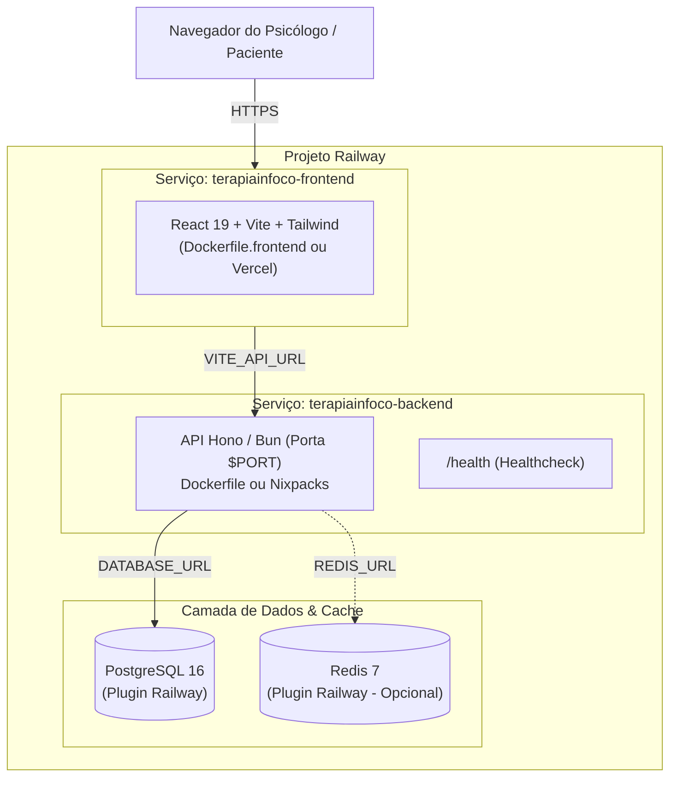

# 🚀 Guia Completo de Deployment no Railway — TerapiaInFoco

Este guia documenta o passo a passo completo para publicar a plataforma **TerapiaInFoco** no **Railway** (`railway.com`), incluindo Banco de Dados PostgreSQL gerenciado, Redis distribuído (opcional), Backend API e Painel Frontend.

---

## 🏗️ Arquitetura no Railway



---

## 📋 Pré-requisitos

1. Conta ativa no [Railway](https://railway.com/).
2. Repositório `terapiainfoco` sincronizado no seu GitHub.
3. Railway CLI instalado (opcional, para deploys via terminal):
   ```bash
   npm i -g @railway/cli
   railway login
   ```

---

## 🛠️ Passo a Passo: Configuração no Railway Dashboard

### 1. Criar um Novo Projeto
1. Acesse o [Dashboard do Railway](https://railway.com/dashboard).
2. Clique em **"New Project"**.
3. Selecione **"Provision PostgreSQL"** primeiro (para criar a base de dados).

---

### 2. Configurar o Banco de Dados PostgreSQL
1. O Railway criará uma instância PostgreSQL automaticamente.
2. Clique no card do PostgreSQL e vá na aba **"Variables"**.
3. O Railway já fornece a variável `DATABASE_URL` (com protocolo `postgresql://...`).
4. **Migrações Automáticas:** O backend do TerapiaInFoco foi programado para aplicar as migrações Drizzle automaticamente assim que o container sobe com a variável `DATABASE_URL`.

---

### 3. Adicionar o Redis (Opcional - Cache & Rate Limiting)
1. No mesmo projeto, clique no botão **"+ New"** no canto superior direito.
2. Selecione **"Database"** ➔ **"Add Redis"**.
3. O Railway criará um nó Redis e disponibilizará a variável `REDIS_URL`.
   > *Nota:* Se não adicionar Redis, o backend ativa automaticamente fallback gracioso em memória RAM com criptografia AES-256-GCM.

---

### 4. Criar o Serviço do Backend (API Hono/Bun)
1. No mesmo projeto, clique em **"+ New"** ➔ **"GitHub Repo"**.
2. Selecione o repositório `terapiainfoco`.
3. O Railway detectará o arquivo [`railway.json`](file:///Users/gilmar/projects/terapiainfoco/railway.json) e o [`Dockerfile`](file:///Users/gilmar/projects/terapiainfoco/Dockerfile) na raiz do projeto.
4. Clique no novo serviço do backend, acesse **"Settings"**:
   - **Service Name:** `terapiainfoco-backend`
   - **Root Directory:** `/` (raiz do monorepo)
   - **Healthcheck Path:** `/health` (já configurado no `railway.json`)
5. Acesse a aba **"Variables"** do serviço e configure as variáveis essenciais:

| Variável | Valor Recomendado | Descrição |
|---|---|---|
| `DATABASE_URL` | `${{Postgres.DATABASE_URL}}` | Vincula a URL do serviço Postgres criado |
| `REDIS_URL` | `${{Redis.REDIS_URL}}` *(se adicionou Redis)* | Vincula a URL do Redis |
| `JWT_SECRET` | `openssl rand -base64 32` | Chave de assinatura dos tokens JWT |
| `BLIND_INDEX_SALT` | `openssl rand -hex 32` | Salt secreto para Blind Index LGPD (CPF/e-mail) |
| `NODE_ENV` | `production` | Modo de execução em produção |

6. **Gerar Domínio Público para a API:**
   - Acesse **"Settings"** ➔ **"Networking"**.
   - Clique em **"Generate Domain"** (ex: `terapiainfoco-backend.up.railway.app`).
   - Copie este domínio gerado.

---

### 5. Configurar o Serviço do Frontend (Painel Clínico)

Você tem duas opções excelentes para o frontend:

#### Opção A: No Próprio Railway (Usando `Dockerfile.frontend`)
1. No projeto Railway, clique em **"+ New"** ➔ **"GitHub Repo"** ➔ selecione `terapiainfoco` novamente.
2. Clique no serviço criado e acesse **"Settings"**:
   - **Service Name:** `terapiainfoco-frontend`
   - **Build:**
     - **Config File / Dockerfile Path:** `Dockerfile.frontend`
3. Vá na aba **"Variables"**:
   - `VITE_API_URL`: Cole a URL pública do backend gerada no Passo 4 (ex: `https://terapiainfoco-backend.up.railway.app/api`).
4. Em **"Networking"**, clique em **"Generate Domain"** para ter seu endereço público do painel.

#### Opção B: Na Vercel ou Cloudflare Pages (Alternativa Gratuita & Rápida)
1. Conecte o repositório na Vercel / Cloudflare Pages.
2. Configure:
   - **Root Directory:** `apps/frontend`
   - **Build Command:** `bun run build`
   - **Output Directory:** `dist`
   - **Environment Variables:** `VITE_API_URL=https://terapiainfoco-backend.up.railway.app/api`

---

## 🔍 Testando o Deployment

### 1. Testar o Healthcheck da API
Abra no navegador ou terminal:
```bash
curl https://seu-backend.up.railway.app/health
```
Resposta esperada (HTTP 200):
```json
{
  "status": "ok",
  "service": "terapiainfoco-backend",
  "version": "1.0.0",
  "rfc": "RFC-001",
  "compliance": {
    "cfp": ["001/2009", "011/2018", "006/2019", "004/2020"],
    "lgpd": ["Art. 5 II", "Art. 11", "Art. 16"]
  },
  "timestamp": "..."
}
```

### 2. Acessar o Painel Clínico
Acesse a URL do frontend gerada. O sistema já virá com suporte adaptativo a Dark/Light Mode e usuário inicial configurado.

---

## 💡 Dicas de Resolução de Problemas (Troubleshooting)

1. **Erro de Conexão com o Banco de Dados:**
   - Garanta que a variável `DATABASE_URL` use a referência de template `${{Postgres.DATABASE_URL}}` fornecida pelo Railway, ou a Connection String da aba **Connect** do Postgres.
2. **CORS (Cross-Origin Resource Sharing):**
   - O backend já vem com middleware CORS permissivo habilitado para endpoints da API (`apps/backend/src/index.ts`).
3. **Persistência de Dados em Memória RAM:**
   - Caso `DATABASE_URL` não seja informada, o backend funciona com PostgreSQL embutido (PGlite WASM), mas os dados se perdem a cada reinicialização do container. Sempre utilize o PostgreSQL do Railway para produção!
