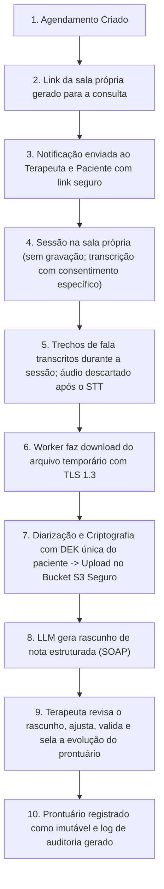

# RFC-001: Plataforma de Gestão Clínica Psicológica com Teleatendimento, Transcrição Assistida por IA e Criptografia LGPD

## 📋 Metadados

| Metadado | Detalhes |
|---|---|
| **Status** | PROPOSTO (DRAFT) |
| **Versão** | 1.2.0 |
| **Data de Criação** | 2026-09-21 |
| **Autor(es)** | Equipe de Arquitetura e Engenharia |
| **Público-Alvo** | Engenharia de Software, Segurança da Informação, Jurídico/DPO, Psicólogos Consultores |
| **Domínio** | Saúde Digital / Telepsicologia / Prontuário Eletrônico / Segurança & Compliance LGPD |

---

## 📑 Sumário

- [1. Sumário Executivo](#1-sumário-executivo)
- [2. Contexto Regulatório e Conformidade (LGPD & CFP)](#2-contexto-regulatório-e-conformidade-lgpd--cfp)
  - [2.1 Requisitos do Conselho Federal de Psicologia (CFP)](#21-requisitos-do-conselho-federal-de-psicologia-cfp)
  - [2.2 Requisitos da LGPD (Lei Geral de Proteção de Dados - Lei nº 13.709/2018)](#22-requisitos-da-lgpd-lei-geral-de-proteção-de-dados---lei-nº-137092018)
- [3. Arquitetura Funcional e Módulos do Sistema](#3-arquitetura-funcional-e-módulos-do-sistema)
  - [3.1 Módulo 1: Agenda e Gestão de Consultas](#31-módulo-1-agenda-e-gestão-de-consultas)
  - [3.2 Módulo 2: Teleconsulta Própria (WebRTC, sem gravação)](#32-módulo-2-teleconsulta-própria-webrtc-sem-gravação)
  - [3.3 Módulo 3: Transcrição, Diarização e Sumarização Clínica](#33-módulo-3-transcrição-diarização-e-sumarização-clínica)
  - [3.4 Módulo 4: Prontuário e Histórico Clínico](#34-módulo-4-prontuário-e-histórico-clínico)
  - [3.5 Módulo 5: Emissão de Relatórios, Laudos e Documentos Psicológicos](#35-módulo-5-emissão-de-relatórios-laudos-e-documentos-psicológicos)
- [4. Arquitetura de Segurança, Criptografia e Privacidade (LGPD)](#4-arquitetura-de-segurança-criptografia-e-privacidade-lgpd)
  - [4.1 Classificação e Mapeamento de Dados](#41-classificação-e-mapeamento-de-dados)
  - [4.2 Arquitetura de Criptografia em Repouso: Envelope Encryption](#42-arquitetura-de-criptografia-em-repouso-envelope-encryption)
  - [4.3 Field-Level Encryption (FLE) e Busca Criptografada](#43-field-level-encryption-fle-e-busca-criptografada)
  - [4.4 Trilha de Auditoria Imutável (Audit Trail)](#44-trilha-de-auditoria-imutável-audit-trail)
- [5. Especificação Técnica e Modelagem](#5-especificação-técnica-e-modelagem)
  - [5.1 Stack Tecnológica Recomendada](#51-stack-tecnológica-recomendada)
  - [5.2 Modelo de Dados Conceitual (Schema Simplificado)](#52-modelo-de-dados-conceitual-schema-simplificado)
  - [5.3 Fluxo Ponta a Ponta: Da Sessão ao Prontuário Enriquecido](#53-fluxo-ponta-a-ponta-da-sessão-ao-prontuário-enriquecido)
- [6. Riscos, Trade-offs e Medidas de Mitigação](#6-riscos-trade-offs-e-medidas-de-mitigação)
- [7. Fases de Implementação e Rollout](#7-fases-de-implementação-e-rollout)
- [8. Apêndice: Decisões de Arquitetura (ADRs)](#8-apêndice-decisões-de-arquitetura-adrs)

---

## 1. Sumário Executivo

Este RFC (*Request for Comments*) formaliza a proposta arquitetural, os requisitos funcionais, o modelo de segurança e a estratégia de conformidade para uma plataforma SaaS especializada no atendimento psicológico individual e em grupo.

O sistema integra:
1. **Gestão Inteligente de Agenda e Consultas:** Agendamento, confirmações automáticas e regras de cancelamento.
2. **Teleconsulta Própria:** Sala de vídeo da plataforma (WebRTC ponta a ponta) para cada consulta, com sala de espera e **sem gravação** de áudio ou vídeo.
3. **Pipeline de Transcrição e Sumarização Clínica:** Transcrição da fala durante a sessão (com consentimento específico e sem armazenar áudio), separação de locutores (terapeuta vs. paciente) e geração assistida de notas de evolução clínica.
4. **Prontuário Eletrônico e Histórico Clínico:** Registro cronológico e imutável de sessões, anamnese e intervenções terapêuticas, em estrita conformidade com o Conselho Federal de Psicologia (CFP).
5. **Geração de Relatórios e Documentos Psicológicos:** Emissão padronizada de laudos, atestados, relatórios de acompanhamento e declarações com assinatura digital.
6. **Arquitetura de Segurança Zero-Trust e Criptografia LGPD:** Criptografia de ponta a ponta em repouso (Envelope Encryption / Field-Level Encryption para PII e dados sensíveis de saúde), em trânsito (TLS 1.3), pseudonimização de registros e trilha de auditoria inviolável.

---

## 2. Contexto Regulatório e Conformidade (LGPD & CFP)

Sistemas de saúde mental operam sob a interseção crítica de sigilo profissional deontológico e legislação de proteção de dados.

### 2.1 Requisitos do Conselho Federal de Psicologia (CFP)

- **Resolução CFP nº 001/2009 e nº 004/2020:** Torna obrigatório o registro documental (prontuário psicológico) para todo atendimento, seja público ou privado. Exige a guarda do prontuário por no mínimo 5 (cinco) anos a partir do último atendimento.
- **Resolução CFP nº 011/2018 (Telepsicologia):** Regulamenta a prestação de serviços psicológicos realizados por meios de tecnologia da informação e comunicação (TIC). O profissional deve estar cadastrado no e-Psi e assegurar a estrita confidencialidade do canal tecnológico utilizado.
- **Resolução CFP nº 006/2019:** Estabelece regras explícitas para a elaboração de documentos escritos produzidos pela(o) psicóloga(o) (Declaração, Atestado Psicológico, Relatório/Laudo Psicológico e Parecer Psicológico).
- **Sigilo Profissional (Art. 9º do Código de Ética Profissional do Psicólogo):** O psicólogo é obrigado a guardar sigilo sobre tudo o que souber em razão do exercício profissional. O sistema deve atuar como operador seguro, garantindo que nenhum terceiro não autorizado (inclusive administradores de infraestrutura) acerte o conteúdo confidencial das sessões.

### 2.2 Requisitos da LGPD (Lei Geral de Proteção de Dados - Lei nº 13.709/2018)

- **Classificação dos Dados (Art. 5º, II):** Notas terapêuticas, transcrições de sessões, histórico emocional e diagnósticos são categorizados como **Dados Pessoais Sensíveis referentes à saúde**.
- **Bases Legais de Tratamento (Art. 11):**
  - **Consentimento específico e destacado** do titular ou responsável legal para a transcrição da sessão e o armazenamento digital (a sessão nunca é gravada — ADR-005).
  - **Tutela da saúde**, com procedimento realizado exclusivamente por profissionais de saúde legalmente habilitados.
- **Retenção vs. Direito ao Esquecimento (Art. 16, I):** O pedido de eliminação de dados pelo paciente encontra limitação no cumprimento de obrigação legal do CFP (guarda obrigatória por 5 anos). O sistema deve segregar os dados arquivados sob retenção legal, revogando o acesso ativo mas mantendo a custódia criptografada até o decurso do prazo.

---

## 3. Arquitetura Funcional e Módulos do Sistema

```
+-----------------------------------------------------------------------------------+
|                                INTERFACE DO USUÁRIO                               |
|          Web App (Terapeuta)          |            Web App / Mobile (Paciente)     |
+---------------------------------------+-------------------------------------------+
                                    | (HTTPS / TLS 1.3)
                                    v
+-----------------------------------------------------------------------------------+
|                               API GATEWAY & AUTH                                  |
|     OAuth 2.0 / OpenID Connect (Keycloak / Auth0) | RBAC / ABAC Policy Engine     |
+-----------------------------------------------------------------------------------+
       |                    |                     |                     |
       v                    v                     v                     v
+--------------+   +------------------+   +---------------+   +--------------------+
|   MÓDULO 1   |   |     MÓDULO 2     |   |   MÓDULO 3    |   |    MÓDULOS 4 & 5   |
|    Agenda    |   | Teleconsulta     |   | Transcrição   |   | Prontuário & Docs  |
|  & Sessões   |   |   & Orquestrador |   |  & Sumarização|   |    (Relatórios)    |
+--------------+   +------------------+   +---------------+   +--------------------+
       |                    |                     |                     |
       +--------------------+---------------------+---------------------+
                                    |
                                    v
+-----------------------------------------------------------------------------------+
|                         CAMADA DE DADOS E SEGURANÇA                               |
|  PostgreSQL (Dados Operacionais)  |  KMS (AWS / GCP / Vault - KEK Management)     |
|  Field-Level Encryption (FLE)     |  Storage S3 Compatível (Transcrições / Laudos)|
|  Trilha de Auditoria Imutável     |  Broker de Filas (RabbitMQ / SQS / Redis)     |
+-----------------------------------------------------------------------------------+
```

### 3.1 Módulo 1: Agenda e Gestão de Consultas

**Funcionalidades Principais:**
- **Configuração de Grade de Horários:** Definição de horários de atendimento, tempo de intervalo (buffer) entre sessões, duração padrão (e.g., 50 minutos) e dias de atendimento.
- **Agendamento Recorrente e Esporádico:** Suporte a consultas semanais ou quinzenais com bloqueio automático de horário.
- **Fluxo de Estados da Sessão:**
  - `SOLICITADA` -> `CONFIRMADA` -> `EM_ANDAMENTO` -> `CONCLUIDA`
  - Estados de exceção: `CANCELADA_PELO_PACIENTE`, `CANCELADA_PELO_TERAPEUTA`, `REAGENDADA`, `NAO_COMPARECEU` (No-show).
- **Notificações e Lembretes:** Envio automatizado de notificações (E-mail transacional e WhatsApp via API oficial da Meta) com 48h e 2h de antecedência, contendo o link dinâmico da sessão.
- **Políticas de Cancelamento:** Bloqueio de cancelamento sem aviso prévio configurável (ex: mínimo 24h antes).
- **Busca Pública de Psicólogos:** Diretório sem login com busca por texto (nome, abordagem, especialidade, apresentação; sem acento e por prefixo) e filtros por abordagem, especialidade e valor máximo da sessão.
  - Perfis públicos ficam na tabela relacional `therapist_profiles` com índice full-text (`tsvector` + GIN, configuração `simple` sobre texto normalizado). É a primeira entrega da fase 2 do ADR-004.
  - Só aparecem perfis **publicados pelo psicólogo** e com **CRP verificado por um administrador** (conferência no Cadastro Nacional de Psicólogos do CFP). A reprovação despublica o perfil.
  - O perfil público contém apenas dados profissionais (nunca dados de pacientes), e abordagens/especialidades seguem catálogos controlados para manter os filtros consistentes.
- **Agendamento a partir da Busca:** O paciente autenticado agenda com o psicólogo escolhido, com aceite obrigatório do TCLE.
  - O registro clínico do paciente nasce **no consultório do psicólogo**, no primeiro agendamento, vinculado à conta (`linkedUserId`). Cada consultório mantém seu próprio prontuário.
  - O cadastro da conta não cria prontuário e não aceita vínculo a um registro existente.
  - O consentimento de transcrição nunca é presumido pelo agendamento.

### 3.2 Módulo 2: Teleconsulta Própria (WebRTC, sem gravação)

A sessão acontece em uma sala de vídeo da própria plataforma (ADR-005), e não em ferramentas de terceiros.

1. **Sala por consulta:** cada consulta tem um link próprio (`PUBLIC_APP_URL/?sala=<id da consulta>`), que não contém segredo. Entram somente o psicólogo do consultório e o paciente daquela consulta, autenticados (§4.5).
2. **Mídia ponta a ponta:** áudio e vídeo trafegam diretamente entre os navegadores (WebRTC P2P cifrado com DTLS-SRTP). O backend só faz a sinalização (oferta/resposta SDP e candidatos ICE) e nunca recebe a mídia da chamada. Servidores STUN/TURN são configuráveis por ambiente; o TURN garante conexão em redes restritivas.
3. **Sala de espera (CFP nº 011/2018):** o paciente aguarda até o psicólogo admiti-lo, o que impede que alguém entre durante o atendimento anterior.
4. **Sem gravação:** nenhuma gravação de áudio ou vídeo é feita, nem no navegador nem no servidor.

### 3.3 Módulo 3: Transcrição, Diarização e Sumarização Clínica

A transcrição constitui o dado mais sensível de todo o ecossistema e deve ser tratada com governança rigorosa.

**Transcrição durante a sessão, sem gravação (ADR-005):**
- Cada participante envia ao backend trechos de ~8 s do **próprio microfone** (Opus a 32 kbps, codificado só em memória; trechos sem voz não são enviados). Por isso, o locutor (terapeuta ou paciente) é conhecido na origem.
- O backend repassa cada trecho a um provedor de Speech-to-Text contratado como operador (LGPD Art. 39), com política de não retenção, e **descarta o áudio** assim que recebe o texto. O áudio nunca é gravado em disco nem no banco.
- Só o texto transcrito, cifrado, segue para o pipeline abaixo. Sem consentimento específico e vigente do paciente para transcrição, nenhum áudio é enviado.
- O rascunho SOAP usa automaticamente a transcrição da sessão. Texto colado manualmente continua aceito, e o diálogo de exemplo só existe em `DEMO_MODE`.

**Pipeline de Processamento Pós-Sessão:**
1. **Consentimento Verificado:** O job de transcrição só inicia se houver flag de consentimento ativo do paciente registrado no banco.
2. **Diarização de Locutores:** Segregação das falas: `[TERAPEUTA]` vs. `[PACIENTE]`.
3. **Criptografia Imediata do Texto:** O texto transcrito é imediatamente criptografado; o áudio de cada trecho existe apenas em memória durante a chamada ao provedor de STT.

**Sumarização Clínica Assistida por IA:**
- A transcrição é submetida a um modelo de linguagem com *zero data retention policy* (ex: Azure OpenAI HIPAA-compliant ou Google Cloud Vertex AI com salvaguardas contratuais de não retenção para treino).
- O prompt gera um rascunho estruturado no modelo SOAP (*Subjetivo, Objetivo, Avaliação, Plano*):
  - **S (Subjetivo):** Principais relatos, queixas e sentimentos expressos pelo paciente.
  - **O (Objetivo):** Observações comportamentais e afeto demonstrado.
  - **A (Avaliação):** Hipóteses clínicas levantadas pelo psicólogo durante o diálogo.
  - **P (Plano):** Tarefas de intervenção acordadas para a próxima sessão.
- **Fidelidade à transcrição:** o modelo recebe só as falas, sem nome nem identificadores do paciente (`store: false`), e usa exclusivamente o que foi dito. Seção sem base na conversa vem como "Sem informações suficientes na transcrição." e o CID-11 só é sugerido quando há fundamento; não existe CID padrão. Padrão: OpenAI `gpt-4o-mini` (`SOAP_MODEL`); `zeroRetentionGuaranteed` só é marcado com acordo de ZDR (`OPENAI_ZERO_DATA_RETENTION=true`). O modelo por regras (`SOAP_PROVIDER=template`) existe apenas fora de produção.
- **Revisão Humana Obrigatória (*Human-in-the-Loop*):** O psicólogo recebe o rascunho de evolução, edita, aprova e sela o prontuário. A IA nunca assina ou salva a evolução final autonomamente.

### 3.4 Módulo 4: Prontuário e Histórico Clínico

O histórico do paciente é o coração legal da prática clínica.

**Estrutura do Prontuário:**
- **Ficha de Admissão / Anamnese:** Histórico biopsicossocial, queixa principal, rede de apoio, medicamentos em uso, tentativas prévias de tratamento.
- **Folhas de Evolução de Sessão:** Número da sessão, data/hora, modalidade (teleconsulta), resumo do atendimento, técnicas aplicadas e encaminhamentos.

**Imutabilidade e Trilha de Auditoria:**
- Uma vez assinada e salva a evolução da sessão pelo psicólogo, o registro torna-se somente leitura (*append-only*).
- Qualquer correção posterior é feita mediante termo de retificação vinculado ao registro original, preservando o histórico original intacto.

**Anotações Confidenciais do Terapeuta vs. Registro Documental:**
- **Segregação lógica:** o sistema separa as anotações estritamente reflexivas do terapeuta (não integrantes do prontuário oficial) do prontuário formal que o paciente tem direito de acesso por lei.

### 3.5 Módulo 5: Emissão de Relatórios, Laudos e Documentos Psicológicos

Em conformidade com a Resolução CFP nº 006/2019, o sistema disponibiliza templates estruturados:

| Tipo de Documento | Finalidade | Estrutura Obrigatória (CFP) |
|---|---|---|
| **Declaração** | Comprovar comparecimento/acompanhamento. | Identificação, texto declaratório de datas e horários, encerramento. |
| **Atestado Psicológico** | Atestar condições psicológicas para finalidades específicas. | Identificação, descrição justificada e conclusão fundamentada. |
| **Relatório Psicológico** | Exposição descritiva sobre o processo terapêutico. | Identificação, descrição da demanda, procedimento, análise e conclusão. |
| **Laudo Psicológico** | Resultado de processo de avaliação psicológica pericial. | Estrutura técnica detalhada com instrumentos utilizados e conclusões diagnósticas. |

**Recursos de Segurança dos Documentos:**
- Geração em PDF/A (padrão de preservação a longo prazo).
- **Assinatura Digital:** Integração com certificado digital ICP-Brasil (PAdES) ou assinatura eletrônica qualificada/avançada (Lei nº 14.063/2020).
- **QR Code com Token de Validação Pública:** Permite que terceiros (médicos, órgãos jurídicos, planos de saúde) validem a autenticidade e integridade do documento emitido sem expor os dados internos do prontuário.

---

## 4. Arquitetura de Segurança, Criptografia e Privacidade (LGPD)

O princípio central é: **Nem mesmo os administradores da infraestrutura ou invasores com acesso direto ao banco de dados relacional devem ser capazes de ler o conteúdo clínico ou identificar os pacientes sem as chaves criptográficas.**

```
+------------------------------------------------------------------------------------+
|                FLUXO DE ENVELOPE ENCRYPTION (AES-256-GCM + KMS)                    |
+------------------------------------------------------------------------------------+
                                                                                     
           [GCP Cloud KMS / AWS KMS / HashiCorp Vault]                                
                             |                                                       
                 Master Key (KEK - Key Encryption Key)                                
                             |                                                       
                             v                                                       
                  Gera / Decripta DEK                                                
                             |                                                       
                             v                                                       
       +---------------------------------------------+                               
       |      DEK (Data Encryption Key) em Memória    |                               
       +---------------------------------------------+                               
               |                               |                                     
               v                               v                                     
      Encripta Dados PII              Encripta Transcrições                          
   (Nome, CPF, Contato, etc.)       & Evoluções do Prontuário                        
               |                               |                                     
               v                               v                                     
  [Banco de Dados Relacional]        [Object Storage Criptografado]                  
   - ciphertext_pii                  - ciphertext_notes                              
   - encrypted_dek (armazenada)      - iv_nonce + auth_tag                           
+------------------------------------------------------------------------------------+
```

### 4.1 Classificação e Mapeamento de Dados

| Categoria | Campos de Exemplo | Sensibilidade | Estratégia de Proteção |
|---|---|---|---|
| **Metadados de Sistema** | IDs técnicos (UUID), logs de rede, timestamps | Baixa | Armazenamento padrão |
| **PII Padrão** | Nome, E-mail, Telefone, Data de Nascimento, CPF | Alta | Criptografia de Coluna (FLE), Hashing com Salt (para busca indexada) |
| **Dados Sensíveis de Saúde** | Prontuário, Notas, Transcrições, Diagnósticos, Laudos | Crítica (Extrema) | Envelope Encryption (AES-256-GCM), KEK rotativa, isolamento lógico |
| **Credenciais e Tokens** | Tokens de acesso Google OAuth, Refresh Tokens | Crítica | Secrets Manager / Vault com AES-256 |

### 4.2 Arquitetura de Criptografia em Repouso: Envelope Encryption

Para evitar o uso de uma única chave mestre para decriptar todo o banco de dados (o que criaria um ponto único de falha desastroso), adota-se o padrão Envelope Encryption:

- **KEK (Key Encryption Key):**
  - Custodiada exclusivamente dentro de um Hardware Security Module (HSM) gerenciado (AWS KMS, GCP Cloud KMS ou HashiCorp Vault).
  - A KEK nunca sai do KMS em texto claro.
  - Políticas de rotação anual automática de KEK.
- **DEK (Data Encryption Key):**
  - Uma chave simétrica AES-256 gerada dinamicamente pelo KMS para cada contexto (e.g., uma DEK única por terapeuta ou por paciente).
  - O dado clínico (nota de sessão, transcrição, PII) é encriptado na camada de aplicação usando algoritmo AES-256-GCM (Galois/Counter Mode), que oferece autenticidade e integridade via Auth Tag.
  - A DEK é salva encriptada (`encrypted_dek`) junto ao registro no banco de dados.
- **Decriptação na Aplicação:**
  1. Para ler a sessão, o backend envia a `encrypted_dek` ao KMS;
  2. O KMS valida permissões e retorna a `plaintext_dek` somente em memória RAM;
  3. A aplicação decripta o texto para a visualização do terapeuta e descarta a chave da memória após a requisição (*zeroization*).

### 4.3 Field-Level Encryption (FLE) e Busca Criptografada

Para permitir a busca de pacientes por CPF ou E-mail sem expor os dados em texto claro:
- **Blind Index (HMAC-SHA256):**
  - Cria-se uma coluna indexada contendo o hash do CPF computado com uma chave de salt secreta (`cpf_bindex = HMAC_SHA256(cpf_limpo, salt_secret)`).
  - A busca exata é realizada comparando o hash de busca com o `cpf_bindex`. O CPF original é armazenado criptografado em `cpf_encrypted`.

### 4.4 Trilha de Auditoria Imutável (Audit Trail)

Todo acesso a dados sensíveis deve ser registrado para conformidade com a LGPD e exigências de ética médica:
- Registra: `timestamp`, `user_id`, `patient_id`, `action` (`READ`, `UPDATE`, `EXPORT`, `TRANSCRIPTION_VIEW`), `ip_address`, `user_agent`.
- Os logs de auditoria são enviados para um repositório imutável (*Write Once, Read Many* - WORM), como AWS S3 com Object Lock ou Google Cloud Storage Bucket Lock.

### 4.5 Matriz de Acesso por Perfil (RBAC + Posse)

Toda rota exige sessão autenticada (sem token → `401`), exceto vitrine pública, horários livres, agendamento público e validação de documentos. Além do papel, vale a **posse**: a equipe só alcança pacientes, consultas e prontuários do próprio consultório (`therapistId`), e recursos alheios respondem `404` para não revelar sua existência.

| Recurso | Psicólogo(a) titular | Supervisor clínico | Recepção | Paciente | Admin / DPO |
|---|---|---|---|---|---|
| Agenda do consultório | ✅ | ✅ | ✅ | Apenas as próprias consultas (portal) | ❌ |
| Cadastro e contato de pacientes | ✅ | ✅ | ✅ | Apenas o próprio | ❌ |
| Prontuário, anamnese, linha do tempo | ✅ (assina e retifica) | ✅ (leitura e rascunho) | ❌ | Acesso legal via portal/exportação | ❌ |
| Exportação do prontuário | ✅ | ❌ | ❌ | Cofre `.enc` do portal | ❌ |
| Direitos do titular (revogar consentimento, quarentena) | ✅ | ❌ | ❌ | Via solicitação | ✅ (sem leitura clínica) |
| Trilha de auditoria | Histórico de acessos do consultório (sem contagem, hashes ou IDs de outros consultórios) | ❌ | ❌ | ❌ | ✅ (plataforma, RIPD e governança) |
| Governança, RIPD/DPIA e pentest | ❌ | ❌ | ❌ | ❌ | ✅ |
| KMS, backups e hardening de segurança | ❌ | ❌ | ❌ | ❌ | ✅ |
| Segurança pessoal (2FA, passkeys) | ✅ | ✅ | ✅ | ✅ | ✅ |
| Busca de psicólogos | Perfil público próprio (edição) | — | — | ✅ (e sem login) | Verificação de CRP |

- **Navegação dinâmica:** os menus do painel exibem apenas os módulos permitidos ao perfil, a partir de `MODULE_ACCESS` (`@terapiainfoco/shared`). Um teste de contrato garante que todo módulo visível seja autorizado pelo backend e que os ocultos sejam negados.
- Cadastro público: apenas **Paciente** e **Psicólogo(a)**. Contas Admin/DPO são criadas por administrador (`bun run admin:create`).
- Consentimento de transcrição nunca é presumido no cadastro (LGPD Art. 11).

---

## 5. Especificação Técnica e Modelagem

### 5.1 Stack Tecnológica Recomendada

- **Backend:** Go (Golang) ou Node.js (TypeScript / NestJS / Bun & Hono) para serviços de alta performance e tipagem rigorosa.
- **Banco de Dados:** PostgreSQL 16 com suporte a UUIDv4, JSONB criptografado e particionamento temporal.
- **Gerenciamento de Chaves / Segredos:** Google Cloud KMS / AWS KMS + HashiCorp Vault.
- **Mensageria & Filas:** RabbitMQ ou AWS SQS para jobs de transcrição, webhooks e envio de lembretes.
- **Armazenamento de Objetos:** Cloud Object Storage (S3 / GCS) com Server-Side Encryption (SSE-KMS) para transcrições e PDFs.
- **Frontend:** React / Next.js com Tailwind CSS, implementando **autenticação multifator obrigatória (MFA/2FA)** para todos os profissionais.

### 5.2 Modelo de Dados Conceitual (Schema Simplificado)

```sql
-- Extensão para geração de UUID
CREATE EXTENSION IF NOT EXISTS "uuid-ossp";

-- 1. TERAPEUTAS
CREATE TABLE therapists (
    id UUID PRIMARY KEY DEFAULT uuid_generate_v4(),
    crp VARCHAR(20) NOT NULL UNIQUE, -- Registro Profissional
    crp_region VARCHAR(10) NOT NULL,
    status VARCHAR(20) NOT NULL DEFAULT 'ACTIVE',
    encrypted_dek BYTEA NOT NULL,     -- DEK encriptada pela KEK do sistema
    created_at TIMESTAMP WITH TIME ZONE DEFAULT NOW()
);

-- 2. PACIENTES (com isolamento e FLE)
CREATE TABLE patients (
    id UUID PRIMARY KEY DEFAULT uuid_generate_v4(),
    therapist_id UUID NOT NULL REFERENCES therapists(id) ON DELETE RESTRICT,
    
    -- Dados de Identificação Criptografados (AES-256-GCM)
    encrypted_name BYTEA NOT NULL,
    encrypted_email BYTEA NOT NULL,
    encrypted_phone BYTEA NOT NULL,
    encrypted_cpf BYTEA,
    
    -- Blind Indexes para busca exata segura
    email_bindex VARCHAR(64) NOT NULL,
    cpf_bindex VARCHAR(64),
    
    consent_transcription_signed BOOLEAN NOT NULL DEFAULT FALSE,
    consent_signed_at TIMESTAMP WITH TIME ZONE,
    created_at TIMESTAMP WITH TIME ZONE DEFAULT NOW()
);

CREATE INDEX idx_patients_therapist ON patients(therapist_id);
CREATE INDEX idx_patients_email_bindex ON patients(email_bindex);
CREATE INDEX idx_patients_cpf_bindex ON patients(cpf_bindex);

-- 3. AGENDAMENTOS E SESSÕES
CREATE TABLE appointments (
    id UUID PRIMARY KEY DEFAULT uuid_generate_v4(),
    therapist_id UUID NOT NULL REFERENCES therapists(id),
    patient_id UUID NOT NULL REFERENCES patients(id),
    scheduled_start TIMESTAMP WITH TIME ZONE NOT NULL,
    scheduled_end TIMESTAMP WITH TIME ZONE NOT NULL,
    status VARCHAR(30) NOT NULL DEFAULT 'CONFIRMED', 
    -- 'CONFIRMED', 'IN_PROGRESS', 'COMPLETED', 'CANCELED', 'NO_SHOW'
    
    
    created_at TIMESTAMP WITH TIME ZONE DEFAULT NOW()
);

CREATE INDEX idx_appointments_schedule ON appointments(therapist_id, scheduled_start);

-- 4. TRANSCRIÇÕES DE SESSÕES
CREATE TABLE session_transcriptions (
    id UUID PRIMARY KEY DEFAULT uuid_generate_v4(),
    appointment_id UUID NOT NULL UNIQUE REFERENCES appointments(id),
    storage_path VARCHAR(500) NOT NULL, -- Caminho do arquivo encriptado no Bucket
    encrypted_storage_key BYTEA NOT NULL,
    raw_status VARCHAR(30) NOT NULL DEFAULT 'PENDING',
    -- 'PENDING', 'PROCESSING', 'COMPLETED', 'FAILED'
    word_count INT,
    duration_seconds INT,
    created_at TIMESTAMP WITH TIME ZONE DEFAULT NOW()
);

-- 5. PRONTUÁRIOS E EVOLUÇÃO CLÍNICA
CREATE TABLE clinical_records (
    id UUID PRIMARY KEY DEFAULT uuid_generate_v4(),
    appointment_id UUID NOT NULL REFERENCES appointments(id),
    patient_id UUID NOT NULL REFERENCES patients(id),
    therapist_id UUID NOT NULL REFERENCES therapists(id),
    session_number INT NOT NULL,
    
    -- Conteúdo Clínico Criptografado (AES-256-GCM)
    encrypted_soap_subjective BYTEA,
    encrypted_soap_objective BYTEA,
    encrypted_soap_assessment BYTEA,
    encrypted_soap_plan BYTEA,
    encrypted_private_notes BYTEA, -- Notas privadas do terapeuta
    
    is_signed BOOLEAN NOT NULL DEFAULT FALSE,
    signed_at TIMESTAMP WITH TIME ZONE,
    signature_hash VARCHAR(128),
    created_at TIMESTAMP WITH TIME ZONE DEFAULT NOW()
);

CREATE INDEX idx_clinical_records_patient ON clinical_records(patient_id, session_number);

-- 6. AUDITORIA IMUTÁVEL DE ACESSO
CREATE TABLE audit_logs (
    id UUID PRIMARY KEY DEFAULT uuid_generate_v4(),
    actor_id UUID NOT NULL,
    resource_type VARCHAR(50) NOT NULL, -- 'PATIENT', 'CLINICAL_RECORD', 'TRANSCRIPT'
    resource_id UUID NOT NULL,
    action VARCHAR(50) NOT NULL,        -- 'DECRYPT_READ', 'UPDATE', 'GENERATE_REPORT'
    ip_address INET NOT NULL,
    user_agent TEXT,
    timestamp TIMESTAMP WITH TIME ZONE DEFAULT NOW()
);
```

### 5.3 Fluxo Ponta a Ponta: Da Sessão ao Prontuário Enriquecido



---

## 6. Riscos, Trade-offs e Medidas de Mitigação

| Risco Identificado | Impacto | Probabilidade | Medida de Mitigação |
|---|---|---|---|
| **Vazamento de Transcrição de Áudio/Texto** | Catastrófico (Dano moral grave e violação LGPD) | Baixa | Envelope Encryption (AES-256-GCM), descarte de memória RAM, retenção em bucket trancado (WORM), MFA obrigatório. |
| **Alucinação da IA na Evolução Clínica** | Alto (Erro de diagnóstico ou registro falso) | Média | Princípio *Human-in-the-Loop* compulsório: o sistema proíbe arquivamento sem validação e assinatura explícita do terapeuta. |
| **Indisponibilidade do provedor de STT** | Médio (sessão sem transcrição) | Média | A chamada de vídeo independe do STT; a transcrição pode ser feita manualmente pelo psicólogo e o provedor é configurável por ambiente. |
| **Perda ou Quebra de Chave Criptográfica** | Catastrófico (Perda irrecuperável do histórico de 5 anos) | Muito Baixa | Uso de KMS redundante multi-região (GCP Cloud KMS / AWS KMS) com backup de chaves em cold-storage sob protocolo Shamir’s Secret Sharing. |
| **Conflito de Retenção: Exclusão total (LGPD Art. 18) vs. CFP (Guarda de 5 anos)** | Médio (Dilema jurídico) | Média | Fluxo de Pseudonimização e Quarentena: dados de contato são anonimizados, mas prontuário é retido em cofre criptografado até 5 anos (LGPD Art. 16, I). |

---

## 7. Fases de Implementação e Rollout

```
+-----------------------------------------------------------------------------------+
| FASE 1: Fundação & Agenda (Semanas 1 a 4)                                         |
| - Infraestrutura de Autenticação (OAuth 2.0, MFA)                                 |
| - Módulo de Agenda e cadastro de pacientes com FLE e Blind Indexing               |
| - Sala de teleconsulta própria (WebRTC P2P) com sala de espera                    |
+-----------------------------------------------------------------------------------+
                                         |
                                         v
+-----------------------------------------------------------------------------------+
| FASE 2: Prontuário Eletrônico & Conformidade CFP (Semanas 5 a 8)                 |
| - Modelagem e encriptação de dados clínicos (SOAP)                                |
| - Módulo de documentos (atestados, relatórios e declarações com validação QR)     |
| - Trilha de auditoria imutável (Audit Trail)                                      |
+-----------------------------------------------------------------------------------+
                                         |
                                         v
+-----------------------------------------------------------------------------------+
| FASE 3: Transcrição Assistida & Inteligência Clínica (Semanas 9 a 12)             |
| - Transcrição da sessão em tempo real (STT sem gravação)                          |
| - Pipeline de diarização e geração de rascunhos SOAP via LLM seguro               |
| - Painel de revisão do terapeuta (Human-in-the-loop)                              |
+-----------------------------------------------------------------------------------+
                                         |
                                         v
+-----------------------------------------------------------------------------------+
| FASE 4: Auditoria de Segurança, Pentest & Go-Live (Semanas 13 a 14)               |
| - Auditoria externa de conformidade LGPD e segurança cibernética (Pentest)        |
| - Treinamento de psicólogos piloto e homologação final                            |
+-----------------------------------------------------------------------------------+
```

---

## 8. Apêndice: Decisões de Arquitetura (ADRs)

### ADR-001: Uso de Google Meet em detrimento de WebRTC próprio
- **Status:** Substituído pelo ADR-005 (2026-10-19).
- **Decisão:** Utilizar Google Meet.
- **Justificativa:** O custo de infraestrutura WebRTC com gravação em nuvem e SFU próprio é proibitivo no estágio inicial; o Google Meet possui alta confiabilidade de rede, ampla aceitação pelos pacientes e recurso nativo de transcrição.

### ADR-002: Adoção de Envelope Encryption (KMS + AES-256-GCM)
- **Decisão:** Criptografia na camada de aplicação em vez de apenas criptografia de disco transparente (TDE).
- **Justificativa:** A TDE protege contra roubo físico de HDs, mas não contra vazamento de credenciais do banco ou SQL Injection. A encriptação em nível de aplicação garante confidencialidade mesmo se houver dump total da base.

### ADR-003: Retenção de Dados Clínicos por 5 anos com chave em quarentena
- **Decisão:** Em caso de cancelamento da conta pelo terapeuta ou pedido do paciente, os dados são trancados por 5 anos conforme a Resolução CFP nº 001/2009 antes do *shredding* criptográfico definitivo.

### ADR-004: Persistência durável do cache de domínio via `entity_store` (PostgreSQL)
- **Status:** Aceito (2026-10-19).
- **Contexto:** Os services do backend operam sobre coleções síncronas em memória (`memoryDb`). Apenas usuários, pacientes e agendamentos eram copiados para o PostgreSQL, em *fire-and-forget*; prontuários, documentos, transcrições, recibos e a trilha de auditoria se perdiam a cada redeploy. Converter ~350 pontos de acesso síncronos em repositórios SQL assíncronos de uma só vez teria risco alto.
- **Decisão:** O PostgreSQL passa a ser a fonte de verdade de **todas** as coleções, e a memória vira cache:
  1. Cada entidade é gravada como documento JSONB na tabela `entity_store (collection, id, data, updated_at)`, preservando os campos já cifrados (FLE AES-256-GCM): o banco nunca recebe texto claro que antes não recebia.
  2. No boot, o cache é carregado do `entity_store`. Registros das tabelas relacionais legadas (`users`, `patients`, `appointments`) são importados uma única vez.
  3. Um middleware grava, em uma transação e **antes da resposta ser enviada**, toda entidade criada, alterada (inclusive mutações in-place) ou removida durante a requisição. Se a gravação falhar, a resposta vira `503`.
  4. Um flush periódico cobre mutações de jobs/timers, uma varredura completa periódica cobre referências retidas, e o `SIGTERM` grava o que estiver pendente.
  5. Em produção, a ausência de `DATABASE_URL` ou das chaves `FIELD_ENCRYPTION_KEY`/`KMS_MASTER_KEY` impede o boot.
- **Consequências e limites:**
  - Durabilidade imediata para todo o domínio sem reescrever os services.
  - **Instância única:** o cache não é compartilhado entre réplicas. Escalar horizontalmente exige concluir a fase 2.
  - Todo o conjunto de dados fica em RAM (adequado ao porte atual de uma clínica).
  - Consultas analíticas/busca não usam índices SQL sobre o JSONB.
- **Fase 2 (evolução):** Promover os domínios centrais (usuários, pacientes, agendamentos, prontuários, perfis públicos de psicólogos) a repositórios SQL assíncronos com tabelas relacionais e índices, removendo-os do cache. Funcionalidades novas que dependem de consulta, como a busca de psicólogos, já nascem em tabelas relacionais.
  - **Andamento:** perfis públicos (`therapist_profiles`), contas de usuário (`users`, via `UserRepository`) pacientes (`patients`, via `PatientRepository`, com PII cifrada e buscas por blind index no SQL) consultas (`appointments`, via `AppointmentRepository`, com o conflito de agenda resolvido no SQL) e prontuários SOAP (`clinical_records`, via `ClinicalRecordRepository`, conteúdo cifrado) já são repositórios SQL. Os domínios centrais da fase 2 estão concluídos; o que segue no cache por instância (KMS, rate limit, ledger de consentimento, tokens efêmeros, sinalização WebRTC e as coleções auxiliares do `entity_store`) ainda impede várias réplicas. A política de posse (`accessPolicy`) consulta o banco e é assíncrona. Alterações em entidades de repositório só valem após `save` explícito (não há flush automático), e um lint de promessas (`no-floating-promises`, `no-misused-promises`) no CI impede `await` esquecido, que tornaria checagens de acesso sempre verdadeiras.

### ADR-005: Teleconsulta própria sem gravação, com transcrição por STT no servidor
- **Status:** Aceito (2026-10-19). Substitui o ADR-001.
- **Contexto:** A plataforma mantinha dois caminhos de teleconsulta: Google Meet (link por agendamento via OAuth e conta Workspace) e uma sala nativa experimental. Isso duplicava a experiência e dependia de um terceiro de videoconferência para dados de saúde. A transcrição prevista dependia de gravações no Google Drive.
- **Decisão:**
  1. A teleconsulta acontece **somente** na sala própria (WebRTC P2P). A integração com o Google Meet é removida (OAuth, criação de salas, campos `meet*` das consultas).
  2. **Nenhuma gravação** de áudio ou vídeo é realizada.
  3. A transcrição é feita durante a sessão: cada participante envia trechos do próprio microfone ao backend, que os repassa a um provedor de STT contratado (padrão: OpenAI, configurável) e descarta o áudio imediatamente. Só o texto, cifrado, é armazenado e alimenta o rascunho SOAP com revisão humana.
- **Consequências:**
  - Menos dependências externas e experiência única para paciente e psicólogo.
  - O provedor de STT é um operador de dados de saúde e exige contrato com política de não retenção.
  - O TURN é necessário para conexões em redes restritivas (configurável por ambiente).
  - Chamadas em grupo exigiriam um SFU, fora do escopo atual (atendimento individual).

---

*Fim do documento RFC-001. Comentários, sugestões e pedidos de esclarecimento devem ser encaminhados para a equipe técnica responsável.*
